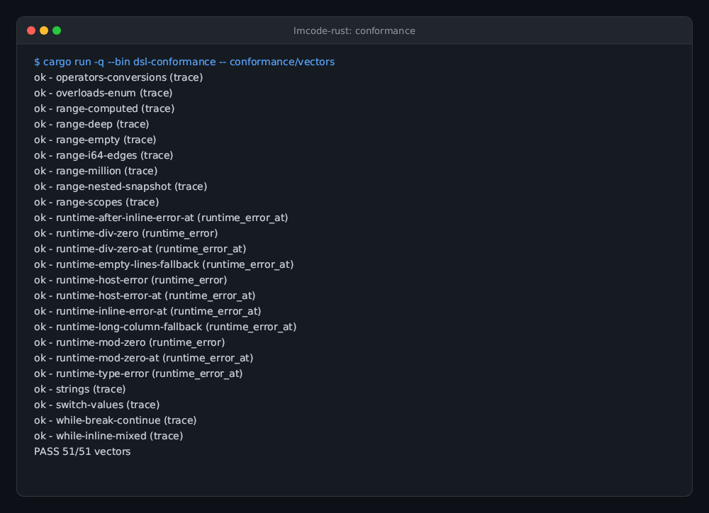
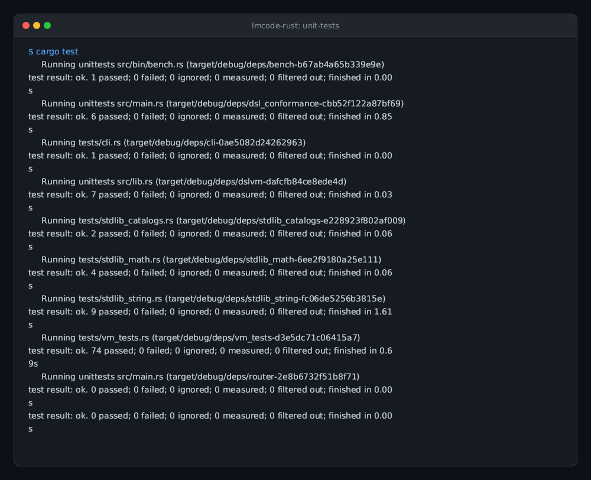
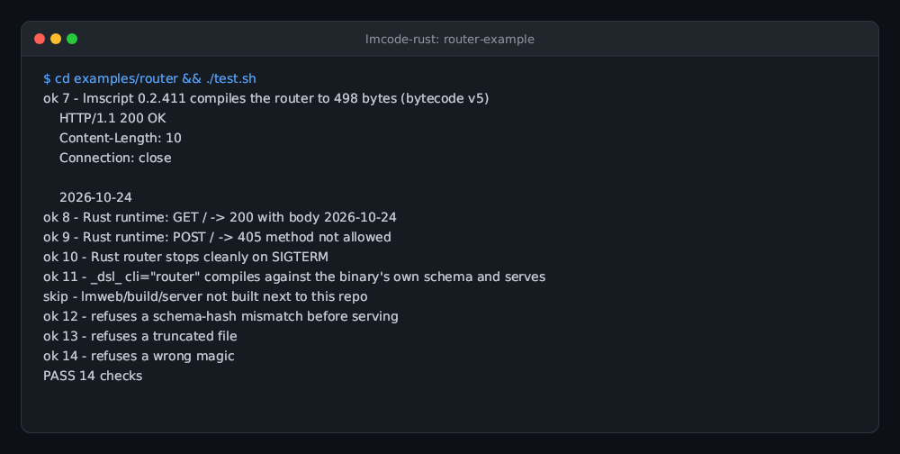
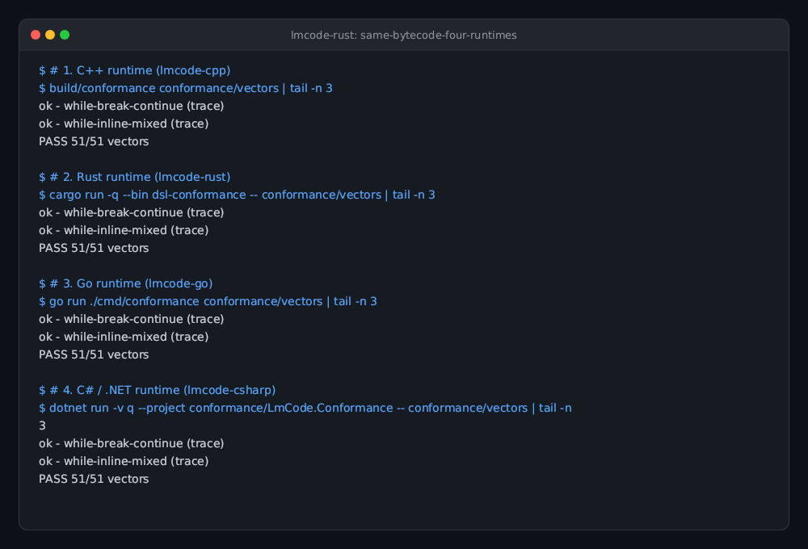

# lmcode-rust

Status: experimental; bytecode compatibility is not promised. Requires a Rust toolchain; the router checks also use curl and lmscript.

`lmcode-rust` is the Rust runtime for lmscript bytecode v6. It provides the `dslvm`
crate, a loader, structural verifier, stack VM, typed host registry, and a conformance
runner over the shared SDK vectors. The workspace has no external Rust crate
dependencies.

Install Rust stable and the published compiler, then run the lmscript test driver:

```sh
npm install -g @lmctl-ai/lmctl
lmscript test.lms
# Equivalent: lmctl test.lms
```

The optional HTTP router integration checks run with `bash examples/router/test.sh`.

## Gallery

| **Bytecode Conformance Suite** | **Unit Tests & Invariants** |
| --- | --- |
|  |  |
| All 70 core bytecode vectors pass across opcodes, types, error paths, and control flow.<br>`cargo run --bin dsl-conformance -- conformance/vectors` | 74 VM tests, string catalog tests, and type invariants passing.<br>`cargo test` |

| **Router Example Host** | **Same Bytecode, Four Runtimes** |
| --- | --- |
|  |  |
| Real HTTP router running compiled lmcode routing logic in pure Rust.<br>`bash examples/router/test.sh` | Cross-language parity: C++, Rust, Go, and C# run the exact same bytecode.<br>`Historical v5 parity; v6 ports are rolling out` |

The test requires `lmscript` (or `lmctl`) 0.2.346 or newer from `PATH`. It compiles the public
router example, runs it on the Rust host, checks the shared vectors, and uses a sibling
`lmweb` checkout when available for cross-runtime comparison. The test accepts
`LMWEB_DIR`; before the repository move it also recognizes the legacy sibling checkout.

The router follows the lmcode host flag standard (lmscript R42). Its schema is embedded at
build time (`include_bytes!`), and bytecode is verified against those exact bytes:

```sh
router --lmcode FILE [--port N]     # load, verify against the embedded schema, serve
router --lmcode-schema              # human summary: context/fn lines, then Owner: and "  Owner.method(...)" lines
router --lmcode-schema --json       # the embedded schema bytes, exactly
router --lmcode-signatures          # one canonical signature per line (as `lmscript --lmcode-signatures SCHEMA`)
```

The former `--schema FILE` flag is refused. Any other combination of these flags exits 2
with empty stdout. `Registry::schema_summary()` produces the summary, so every Rust host
prints the same format.

The runtime API is small: register context objects, typed methods, and typed host
functions; load bytecode with the exact schema bytes (embed them in the host binary); create a host context; and run
the program. Handles remain owned by the host. Schema 2 supports overloads, declared
conversions, operators, enums, and `returns: "self"`; compiler-inlined functions do
not add a runtime function table.

`Registry::new()` enables the pinned built-in lmcode standard catalog (`std/lmcode-std.schema.json`, 182 signatures). Use `Registry::without_std()` for a legacy host surface, or call `stdlib::register_std(&mut registry)` explicitly; registration is idempotent. Verify the canonical schema copy with `scripts/sync-std.sh --verify` and `std.lock`.

The common language includes typed locals, branching, range and collection loops,
`foreach`, `switch`, `while`, `break`, `continue`, and source-located runtime errors.
Collections remain schema objects with methods such as `len()` and `at(i)`. The Rust
runtime and the C++ reference runtime consume the same portable schema-bound format.

The workspace metadata identifies the public repository and MIT license. See
[LICENSE](LICENSE) and [THIRD_PARTY_NOTICES.md](THIRD_PARTY_NOTICES.md). Related
projects are [lmcode-cpp](https://github.com/lmctl-ai/lmcode-cpp),
[lmapi](https://github.com/lmctl-ai/lmapi), [lmrust](https://github.com/lmctl-ai/lmrust),
and [lmcpp](https://github.com/lmctl-ai/lmcpp).

## Sibling runtimes

The same bytecode v6 and the same conformance vectors are implemented by [lmcode-cpp](https://github.com/lmctl-ai/lmcode-cpp),
[lmcode-rust](https://github.com/lmctl-ai/lmcode-rust), [lmcode-go](https://github.com/lmctl-ai/lmcode-go) and
[lmcode-csharp](https://github.com/lmctl-ai/lmcode-csharp). Each is a library that turns an AOT executable into an lmscript host.

## Standard library catalog

`Registry::new()` installs lmcode std automatically, without group-registration calls or handwritten std declarations. Until compiler injection lands, use `scripts/merge-std.py` to combine the pinned `std/lmcode-std.schema.json` with the host schema at build time, and embed those exact merged bytes. The `stdlib::register_*` functions remain compatibility APIs for explicit opt-out registries. The v3 catalog has 182 signatures: the original string, math, collection and file surface plus typed Int/Float maps, Int/Float/Str stacks, queues and stable min-first priority queues, immutable Json, strict byte Base64/hex codecs, and map key/value snapshots. Install current `@lmctl-ai/lmctl` for v3 catalog and v6 entry support.
Run `cargo test -p dslvm --test stdlib_catalogs` for exact parity between the explicit canonical schema and the registry; it uses `lmscript` (or `$LMSCRIPT_BIN`) on PATH.

The built-in numeric catalog is also described by `stdlib/math.schema-fragment.json`; it provides int/float overloads of `math_abs`, `math_min`, `math_max`, `math_floor`, `math_ceil`, `math_round`, `math_pow`, and `math_sqrt`. Integer operations wrap at 64 bits, integer roots are exact floor roots, and float operations preserve IEEE NaN, infinity, and signed-zero behavior described by the shared catalog.

Version 2 containers preserve insertion order for typed maps, use non-consuming pop-order `at` for stacks and queues, and use stable min-first priority queues with insertion-order ties. Json parses strict UTF-8 JSON (including escaped NUL), rejects duplicate keys, malformed numbers, BOMs, and nesting beyond 256, and preserves source number/string spellings and object order in compact `to_json()` output. Runtime diagnostics and bounds messages follow the shared catalog vectors.

## VM strings and host text

VM strings are arbitrary bytes: invalid UTF-8 and embedded NUL are legal. Constants, concatenation, equality, and host calls preserve every byte. Lengths and offsets refer to bytes; slices can split UTF-8 codepoints. `Value::Str` stores a `ByteString`; `Value::string(bytes_or_text)` accepts byte vectors, byte slices, and Rust text. Existing direct `Value::Str(String)` constructors should use `Value::string(text)` or `Value::Str(text.into())`.

Host callbacks use `value.as_bytes()?` for unchanged bytes, `value.as_str()?` for validated UTF-8 (a conversion failure is `RUN_HOST`), or `value.to_string_lossy()?` for replacement-character text. `ByteString` also offers `as_bytes()`, `as_str()`, `to_string_lossy()`, and byte indexing. Registry identifiers remain UTF-8 host text. Host adapters such as the router choose their own text validation at their API boundary.

The string catalog uses byte offsets and ASCII case/whitespace rules. Substrings clamp negative starts to zero and overlong counts to the end; negative counts return empty. Search returns the first byte offset, or -1 (0 for an empty needle); replacement consumes non-overlapping matches and treats an empty search as a no-op. Repeat and replacement preflight a 64 MiB output cap, including no-op replacement copies; repeat also rejects negative counts. Numeric parsing accepts complete signed decimal tokens without whitespace, rejects overflow and floating-point underflow to zero, and returns zero on failure (`str_is_int`/`str_is_float` distinguish valid zero). NaN and infinity are invalid; representable subnormals and signed zero are preserved. Glob matching supports `*` (including slash), `?`, classes/ranges, `[!class]`, and backslash escapes. Unterminated classes and trailing backslashes are literal; leading `]` in a class is literal and descending ranges match no bytes. A deterministic 2^27 work cap counts matcher iterations, scanned class entries, and skipped trailing stars. Catalog policy failures return `RUN_HOST`.

The conformance runner also supports the optional catalog fixtures from a matching
C++ checkout, including its raw-byte hex adapters:

```sh
cargo run -p dsl-conformance --bin dsl-conformance -- ../lmcode-cpp/conformance/stdlib-vectors
```

An empty vector directory is an error, never a successful zero-case run.

Built-in std includes strings, math, collections, JSON, and files. `file_read`,
`file_write` (create/truncate), and `file_append` preserve every content byte.
`file_exists` is true only for regular files; missing paths and directories are
false. `file_lines` splits LF bytes into an arena-owned StrList, preserving CR
and empty fields, including the final field (`"a\n"` becomes `["a", ""]`).
Relative paths use the process cwd without sandbox restrictions; Unix passes
path bytes unchanged, while Windows requires UTF-8 paths and supports long names.
Failures trap with `RUN_HOST` and `FUNCTION: PATH: OS_REASON`.
Testing is outside std: hosts declare its separate fragment and explicitly call
`stdlib::register_testing(&mut registry, sink)` for `print`/`assert_close`.

Version 3 adds `str_base64_encode/decode` and `str_hex_encode/decode` over raw
bytes, with no artificial size cap. Base64 uses the RFC 4648 standard alphabet
and canonical padding; decoders reject whitespace, invalid symbols, misplaced
padding and nonzero pad bits. Hex output is lowercase and input accepts either
case. `keys()`/`values()` on StrMap, IntMap and FloatMap allocate independent
mutable list snapshots in insertion order, preserving bytes and float bits.
All snapshots share the 65,536-object run arena. The shared suite now contains
267 catalog vectors plus 70 core vectors.

## Rule entries (R47/R48/R49, lmcode bytecode (DSLB v6))

An annotated `@NAME fn ... implements Interface` is both an inlined source
helper and a host-callable entry. `Program::entries()` returns source-order
`Entry { name, annotation, iface, params, returns }` metadata. Interfaces remain
compiler/schema declarations, not registry callbacks. Pools are shared; body and
entries have independent code, locals, stack facts and source maps.

```rust,ignore
let entry = &program.entries()[0];
assert_eq!(entry.params, ["int"]);
let result = program.call(0, &mut context, &registry, vec![Value::Int(41)])?;
```

`run()` executes only the body. `call()` needs no prior run, initializes parameter
locals and returns the HALT value (`Value::None` for void). It shares execution,
std cleanup and located-error behavior with `run()`. Argument kinds are host-owned;
wrong arity is RUN_HOST: `call entry 'NAME' expects N argument(s); found M`.
The loader verifies parameter count/type/visibility and structural/stack correctness
per entry, even without loops. Version 6 is the only accepted format; recompile
v5 programs against a matching compiler. No new opcode or runtime call stack.

Run `cargo test -p dslvm --test v6_entries` for loader/API controls. The complete
gate includes 70 core vectors and 267 standard-catalog vectors. See
[rule-entry notes](durable-memory/07-rule-entries.md) for pins and the documented
compiler-generator fixture correction. Samples record their independently reviewed SDK commits in sdk.lock.

## Automated tests and releases

Install Rust stable and `npm install -g @lmctl-ai/lmctl` (provides both `lmctl` and `lmscript`). From the repository root run `lmscript test.lms` or `lmctl test.lms`; `test.sh` is a thin wrapper.

Every push to main builds and tests Linux x64/arm64, macOS x64/arm64, and Windows x64 executables. Only after all five jobs pass does Actions publish a GitHub release with platform binaries, licenses and SHA256SUMS. Pull requests run the same tests without publishing.

`examples/rule-entries/rules.lms` defines `@increment fn next(value: int) -> int implements Score`. The Rust embedding example selects the annotation, checks parameter metadata and calls the entry with 41, asserting 42 without running the body first. `test.lms` builds release executables and runs both conformance catalogs and this example. Release assets include router, `dsl-conformance`, and rule-entries.

## Text templates

The standard `template_render(string, Json) -> string` function renders arbitrary text with nested context, indexed lists, loops and boolean conditions. Inserted values remain literal. See the [portable contract and examples](std/template.md).

## Historical literal names

The documentation calls the language lmcode. `--lmcode`, `--lmcode-schema` and `--lmcode-signatures` are current host flag literals; `DSLB` is the bytecode magic and `DSLB v6` is the current format name; `.dslb` is the current bytecode filename extension. Other code-formatted API names, paths, manifest names and diagnostic text retain their current literal spellings.
